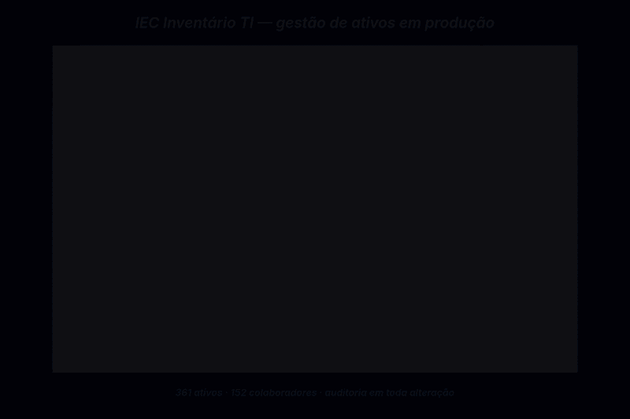

# InventarioIEC — gestão de ativos de TI

**Sistema de inventário de TI em produção no IEC/PUC Minas: ativos, alocações a colaboradores, movimentações e solicitações num só lugar, com auditoria de toda alteração.** Usado por ~10 pessoas da equipe de TI para gerir 361 ativos e 152 colaboradores com suas alocações.



<sub>Vídeo em MP4: [docs/media/inventario-demo.mp4](docs/media/inventario-demo.mp4) · gravado com dados fictícios; os números da legenda são os da produção</sub>

## O problema

A TI precisava de um único lugar para registrar cada ativo (máquinas, notebooks, aparelhos, impressoras, ramais e racks), saber com quem e em qual setor cada um está e reconstruir o histórico de qualquer movimentação — quem alterou o quê e quando.

## Como funciona

```
Login (NextAuth credentials + bcrypt) ── perfis admin e viewer
   │
App Router (Next.js 16)
   ├── dashboard: disponibilidade por setor, KPIs, exportação em PDF
   ├── inventário: máquinas · notebooks · aparelhos · impressoras · ramais · racks
   ├── pessoas: colaboradores · setores · localidades · usuários
   ├── movimentações e solicitações
   └── busca global (Ctrl+K)
   │
API Routes ── validação com Zod ── Prisma ── PostgreSQL (Supabase)
   │
   └── registrarAuditoria() ──► audit_log (dados anteriores e novos em JSON)
```

## Decisões e trade-offs

- **Auditoria como preocupação transversal.** Um único serviço, `registrarAuditoria()` em [`lib/audit.ts`](lib/audit.ts), grava tabela, registro, ação (`CREATE`, `UPDATE`, `DELETE`, `ALOCAR`, `DESALOCAR`…) e o JSON antes/depois. As rotas só o chamam. Falha no log nunca derruba a operação principal.
- **Multi-alocação no modelo de dados.** Um ativo pode ter mais de uma alocação ativa por decisão de design, sem exceções pontuais no código.
- **Banco só por migrations versionadas.** O schema evolui por SQL em [`supabase/migrations`](supabase/migrations), com nome padronizado. A CI ([`database-migrations.yml`](.github/workflows/database-migrations.yml)) aplica as migrations num PostgreSQL descartável e falha se o banco resultante divergir do `schema.prisma`. O fluxo está em [`docs/database-versioning.md`](docs/database-versioning.md).
- **Tabelas genéricas.** Um `DataTable` sobre TanStack Table atende todas as categorias de inventário, com paginação no servidor.
- **Testes em camadas.** Testes unitários e de componentes com Jest + Testing Library em `__tests__/` (inclusive da auditoria) e e2e de autenticação com Playwright em `e2e/`.
- **Desenvolvido AI-first.** Construído com agentes de código guiados por instruções versionadas no próprio repositório ([`AGENTS.md`](AGENTS.md) e [`CLAUDE.md`](CLAUDE.md)), com revisão humana, lint e testes antes de cada merge.

## Resultado

Em produção no IEC/PUC Minas: **~10 usuários da TI, 361 ativos e 152 colaboradores inventariados com suas alocações**, com histórico auditável de cada alteração.

## Stack

Next.js 16 (App Router) · React 19 · TypeScript · Prisma · PostgreSQL/Supabase · NextAuth (credentials + bcrypt) · TanStack Table · React Hook Form + Zod · @react-pdf/renderer · Jest + Testing Library · Playwright

## Como rodar

Requer Node 20+ e um PostgreSQL local.

```bash
npm install
cp .env.example .env.local        # aponte DATABASE_URL e LOCAL_DATABASE_URL para o banco local
npm run db:validate               # valida nomes das migrations e o schema Prisma
npm run db:apply:local            # aplica supabase/migrations no banco local
npx prisma generate
node scripts/hash-senha.js "SuaSenha@123"   # gera o hash e o INSERT do primeiro usuário
npm run dev
```

Use dados fictícios no ambiente local (por exemplo `demo@exemplo.com`).

### Testes

```bash
npm run lint
npm run test        # Jest
npm run test:e2e    # Playwright
```

## Documentação

- [Versionamento do banco](docs/database-versioning.md)
- [Migrations](docs/DATABASE_MIGRATIONS.md)
- [Testes](docs/testing.md)

---

Feito por [Felipe Sobrinho](https://felipe-nephew.vercel.app)
